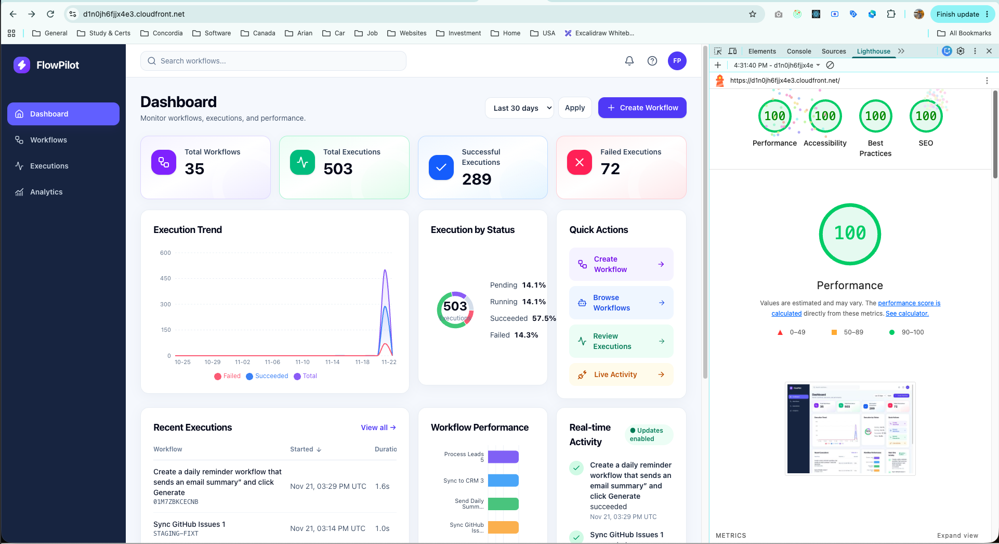

## Enterprise Next.js + NestJS + Apollo Monorepo

Technology: Nx + pnpm + Next.js + NestJS + Apollo GraphQL + LangChain + AWS

- One Next.js application and one NestJS API.
- Application-specific features remain inside their applications.
- Reusable packages are independently managed and npm-ready.
- Atomic Design and Storybook live together.
- Apollo Client is a separate package; server-side Apollo lives directly in `apps/api` (single consumer, no standalone package).
- AppSync Events handles real-time communication.
- `web` is hosted on ECS Fargate (standalone Next.js server, Dockerfile at `apps/web/Dockerfile`) behind CloudFront + S3 for static assets — deliberately not serverless like the rest of the backend: a `min 1` Fargate task gives deterministic per-request latency for SSR/RSC, which matters more here than the backend's scale-to-zero cost savings. See `infra/terraform-web/`.
- Architecture/pipeline diagrams (standalone HTML, open directly in a browser) live in `docs/diagrams/`.



```
next-apollo-monorepo/
│
├── apps/
│   ├── web/                    # Next.js App Router — demo UI for the backend
│   ├── api/                    # NestJS + Apollo Server 5 (code-first GraphQL)
│   ├── ai-worker/              # SQS-triggered AI workflow generation worker
│   └── execution-worker/       # SQS-triggered workflow execution worker
│
├── packages/
│   ├── design-system/          # Shared UI components + Storybook
│   ├── apollo-client/          # Apollo Client + AppSync Events realtime client
│   ├── graphql-contracts/      # Generated schema + typed GraphQL operations
│   ├── ai-helper/               # LangChain model factory + structured generation
│   ├── realtime/                # AppSync Events publish helper
│   ├── auth/                    # Shared authentication
│   ├── shared/                  # Types, utils, validation
│   └── config/                  # Shared tooling configuration
│
├── infra/
│   ├── terraform-backend/       # DynamoDB, Lambdas, API Gateway, SQS, AppSync Events
│   ├── terraform-web/           # VPC, ALB, ECS Fargate, CloudFront + S3 for web
│   └── terraform-bootstrap/     # State bucket + GitHub OIDC IAM roles
│
├── docker-compose.yml           # DynamoDB Local for dev (apps/api)
├── docs/diagrams/                # Standalone HTML architecture/pipeline diagrams
├── .github/                      # CI/CD workflows (lint/test/build, terraform plan/apply,
│                                 #   deploy-backend, deploy-web, release)
│
├── nx.json
├── pnpm-workspace.yaml
├── tsconfig.base.json
└── package.json


                Nx + pnpm Monorepo
                        │
          ┌─────────────┴─────────────┐
          │                           │
      Applications                 Packages
          │                           │
  ┌───┬───┼────────────┐    design-system, apollo-client,
  │   │   │            │    graphql-contracts, ai-helper,
 web api ai-worker  execution-worker   realtime, auth, shared, config
(Next.js)(Nest)  (SQS worker)(SQS worker)


```

## Useful Commands

```
pnpm run dev:web          # run web dev server alone (separate terminal)
pnpm run dev:api          # run api dev server alone (separate terminal)
pnpm --filter api db:up             # start DynamoDB Local (docker-compose)
pnpm --filter api db:create-tables  # create Workflows/Executions tables + GSIs locally
pnpm --filter api db:seed           # seed sample workflows/executions
pnpm run preview:web      # production build + next start, for real Core Web Vitals testing
pnpm run graph            # visualize full project dependency graph
pnpm run show:web         # inspect web's targets/deps
pnpm run show:api         # inspect api's targets/deps
pnpm run affected:build   # build only projects changed vs. base branch
pnpm run affected:test    # test only affected projects
pnpm run affected:lint    # lint only affected projects
pnpm run affected:graph   # visualize only the affected projects vs. base branch
pnpm run affected:list    # plain text list of affected project names
pnpm run reset            # clear Nx cache/daemon when something looks stale
pnpm run release:dry      # preview version bumps/changelogs, no writes
pnpm run release          # bump versions, write changelogs, commit + tag (conventional commits, independent per-project)

pnpm run tf:bootstrap:plan / :apply   # infra/terraform-bootstrap — state bucket + OIDC roles
pnpm run tf:backend:plan / :apply     # infra/terraform-backend — needs TF_VAR_openai_api_key set
pnpm run tf:web:plan / :apply         # infra/terraform-web — needs TF_VAR_graphql_uri set
```

The three Terraform roots are independent (no root reads another's state) — run them in any order. All three scripts pin `AWS_PROFILE=zaplite-dev`, since the shared-credentials-file's `default` profile isn't valid for this account (`terraform-backend`/`-web` need `TF_VAR_openai_api_key`/`TF_VAR_graphql_uri` exported first, or terraform prompts for them).

Versioning is **never automatic per commit** — it only runs when triggered. CI release (`.github/workflows/release.yml`) fires on manual `workflow_dispatch` or a push to `release/**`, not on every merge to `main`, so version tags stay frozen during normal development and only move at an explicit promotion point.

## Skills

- `apollo-client` (`.agents/skills/apollo-client`) — Apollo's official best-practices skill, installed via `npx skills add apollographql/skills --skill apollo-client`. Loaded automatically when working with Apollo Client code.

See [COMMANDS.md](COMMANDS.md) for the full chronological setup log.
